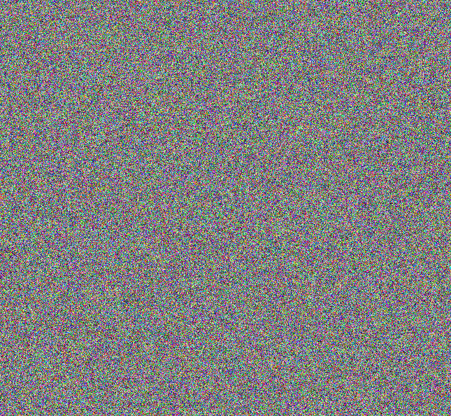
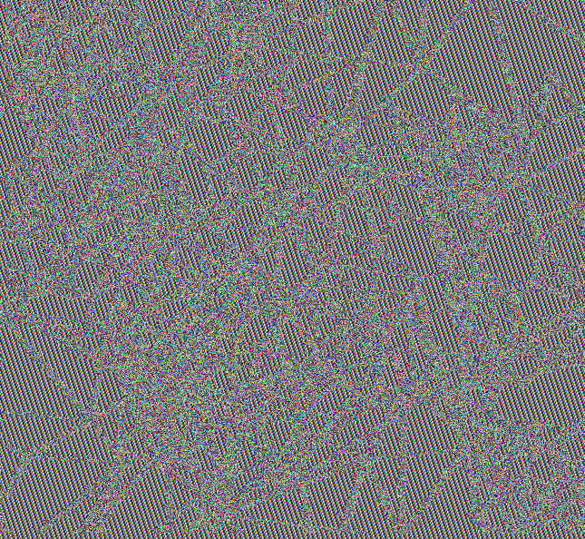
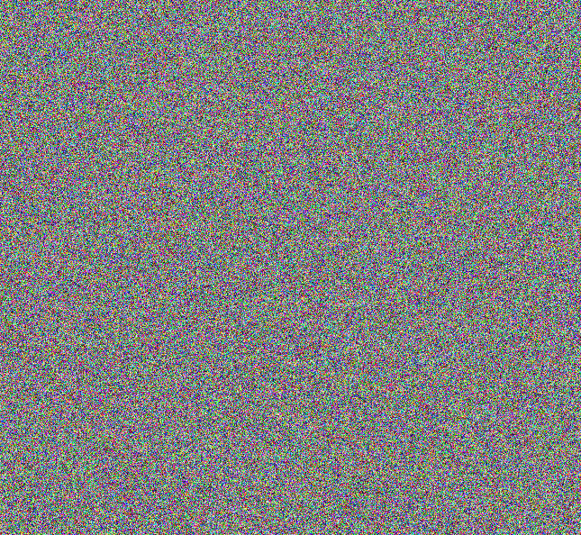
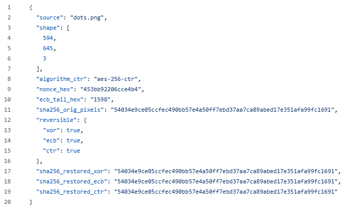
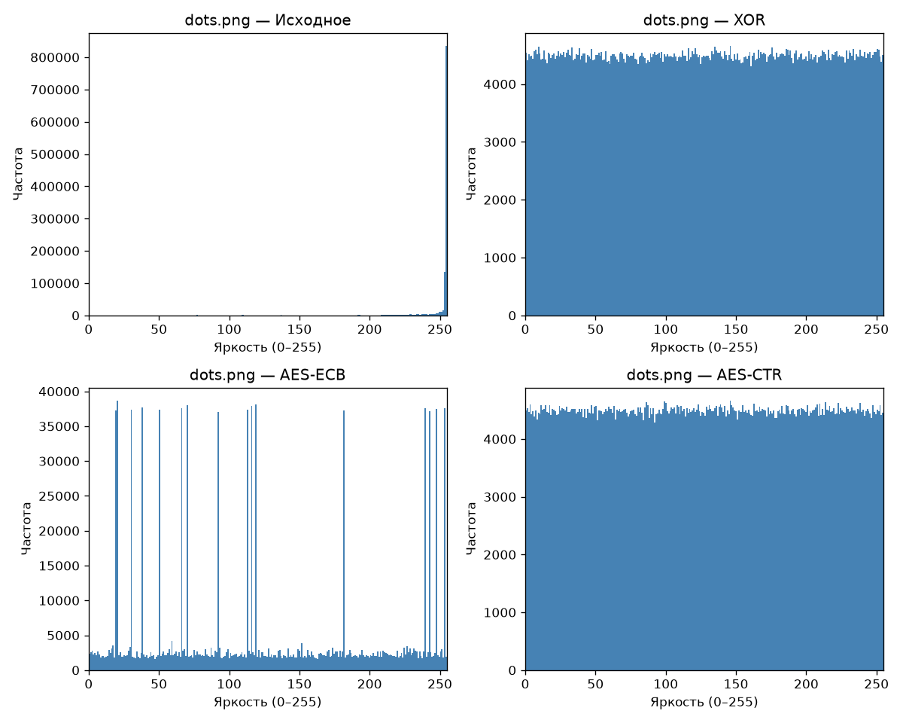

# Шифрование изображений и статистическое сравнение методов

## 1. Описание

В работе используются изображения:
- `checkerboard.png` — шахматная структура;
- `gradient.png` — плавный градиент;
- `dots.png` - точки (собственное изображение).

В папке `results` находятся результаты шифрования по каждой картинке. В папке `results/dots`:
- `_sh.png` - зашифрованные картинки;
- `_dec.png` - восстановленные картинки;
- `meta.json` - параметры шифрования;
- `metrics.csv` - таблица с численными результатами;
- `histograms.png` - гистограммы распределения байтов;
- `key.txt` - результаты эксперимента с изменением ключа.

## 2. Реализация методов
### 1. Потоковый вариант: XOR с ключевым потоком

Реализован потоковый шифр на основе xorshift32: из строки-ключа (`pixels`) через SHA-256 формируется 32-битное начальное состояние, далее генерируется псевдослучайный ключевой поток, который побайтово складывается по XOR с данными изображения. Для расшифрования применяется та же операция XOR с тем же ключом, что обеспечивает полное восстановление исходных байтов.

Зашифрованная картинка:

### 2. AES

AES: ECB и CTR — с использованием криптографической библиотеки `PyCryptodome`. Ключ для шифрования формируется как SHA-256 от строки-ключа. Для ECB применяется дополнение (padding) до кратности блока, а для CTR используется `nonce` длиной 8 байт, который генерируется случайным образом, сохраняется в `meta.json` и применяется при расшифровании.

Зашифрованные картинки:

`ECB`

`CTR`

## 3. Проверка обратимости

Проверим совпадение исходного и восстановленного файлов через SHA-256. На картинке мы видим полное совпадение исходного и восстановленного файлов.

Также в файле `meta.json` можно увидеть подробный вывод:

Все четыре хэша одинаковые. Это доказывает, что исходный файл восстанавливается без ошибок.
Также в этом файле можно увидеть значение `nonce`, оно генерируется случайно для каждого изображения и преобразуется в строку.

## 4. Статистическое сравнение методов

Проведем статистическое сравнение методов на основе изображения `dots.png`.

Сводная таблица метрик:

| № | Метод | Энтропия | Corr H | Corr V |  
| :-: | :-: | :-: | :-: | :-: |  
| 1 | Исходное изображение | 1.997448 | 0.797850 | 0.821183 | 
| 2 | XOR | 7.999847 | -0.008317 | 0.014108 | 
| 3 | AES-ECB | 6.848426 | 0.003322 | 0.029654 |  
| 4 | AES-CTR | 7.999851 | -0.013251 | 0.038010 | 

Гистограмма:

- Энтропия - это численная мера "хаотичности" распределения.

У исходного изображения энтропия минимальна (1.997448), так как изображение содержит множество повторяющихся элементов (сильная избыточность) и ограниченную палитру. У XOR и AES-CTR значения достаточно близкие к максимальным значениям (7.999847 и 7.999851) (считают, что максимум - 8.0), это говорит о том, что распределение стало практически равномерным, на гистограмме это тоже видно. Значения для AES-ECB ниже, чем у остальных методов (6.848426), а на гистограмме видим пики, сохраняется структурная избыточность исходного изображения.

- Корреляция - это численная мера зависимости между соседними пикселями, и её снижение после шифрования — признак эффективного перемешивания данных (для оценки корреляции используется 5000 случайных пар соседних пикселей).

У исходного изображения корреляция по горизонтали (Corr H = 0.797850), а по вертикали (Corr V = 0.821183), зависимость между соседними пикселями около 1, из-за того, что соседние пиксели у `dots.png` похожи (соержатся повторяющиеся элементы). При применении XOR коэффициенты стремятся к нулю (-0.008317 и 0.014108), структура исходного изображения практически разрушена. Аналогично для AES-CTR (-0.013251 и 0.038010). Для AES-ECB корреляция по горизонтали выше, у остальных методов (0.003322), а по вертикали чуть ниже (0.029654), чем у AES-CTR, структура частично сохранена.

Чувствительность к изменению ключа: 

Для метода AES-CTR проведем эксперимент с изменением ключа и рассчитаем метрики NPCR и UACI.
Сначала изображение шифруется ключом KEY1 = "pixels" и случайного `nonce`, затем то же самое изображение шифруется уже другим ключом (просто изменим один символ в KEY1), KEY2 = "pixelс", но с тем же `nonce`, а затем сравниваем два шифротекста и получаем значение метрик:

| Метрика | Значение | Пояснение |
| :-: | :-: | :-: |
| NPCR | 99.6101% | доля различающихся байтов между двумя шифротекстами |
| UACI | 33.4691% | средняя интенсивность различий |

Можно говорить о хорошей чувствительности к ключу: 
- Значение NPCR близко к тому, которое считают идеальным (100%), то есть ключ сильно влияет на результат.
- Значение UACI близко к тому, которое считают идеальным (около 33%), то есть изменения в шифротексте распределены равномерно.

То есть даже минимальное изменение ключа приводит к значительным и равномерно распределённым изменениям в шифротексте.

## 5. Вывод

Эксперимент показал, что важно выбрать метод для шифрования изображений:

- при использовании AES-ECB: на исходном изображении присутствовали повторяющиеся элементы, этот метод сохранил визуальные контуры;
- при использовании XOR: формально обеспечивается равномерный шум, но метод не обладает криптостойкостью из-за линейности генератора хоть и показал практически равномерное распределение байтов;
- при использовании AES-CTR: структура исходного изображения практически разрушена, метод показал самую большую энтропию (7.999851) среди всех методов.

Таким образом, можно сделать вывод, что для практического применения в задачах защиты изображений оптимальным выбором является AES-CTR, обеспечивающий наилучшее разрушение статистической структуры изображения и высокую криптостойкость.
