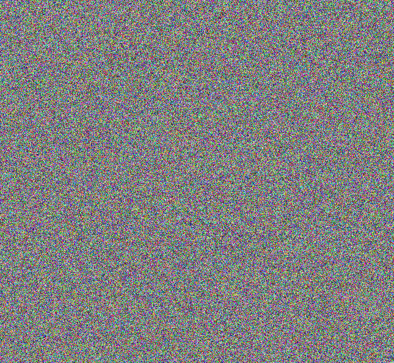
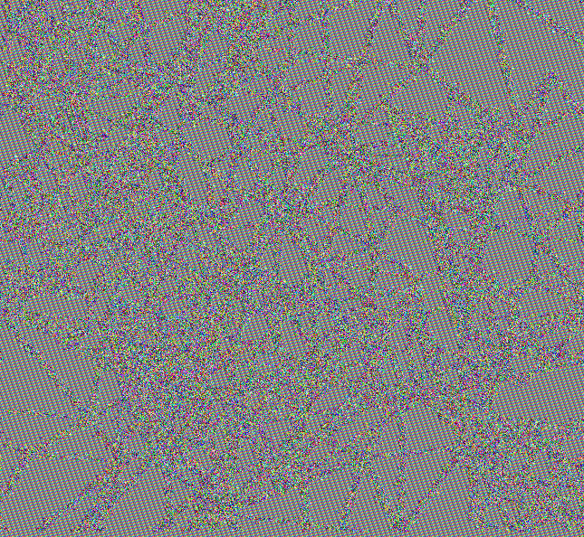
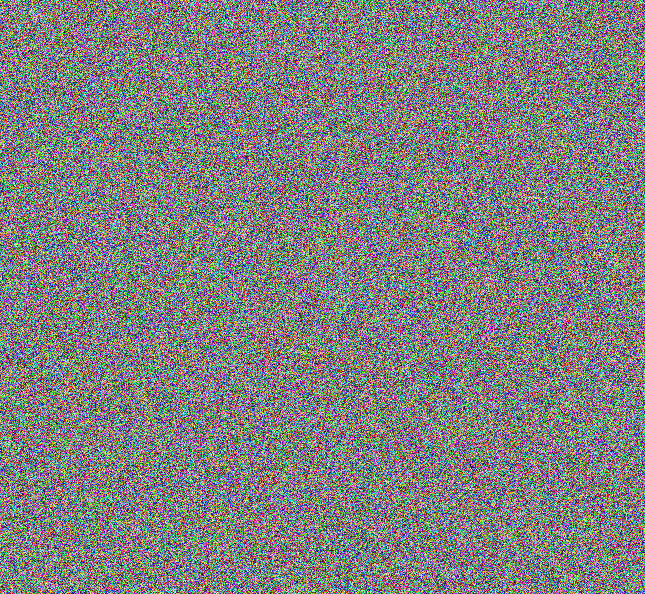
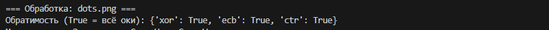
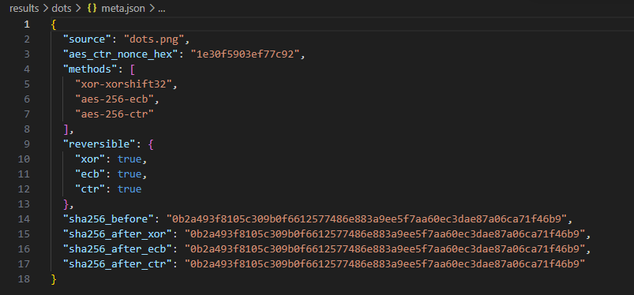
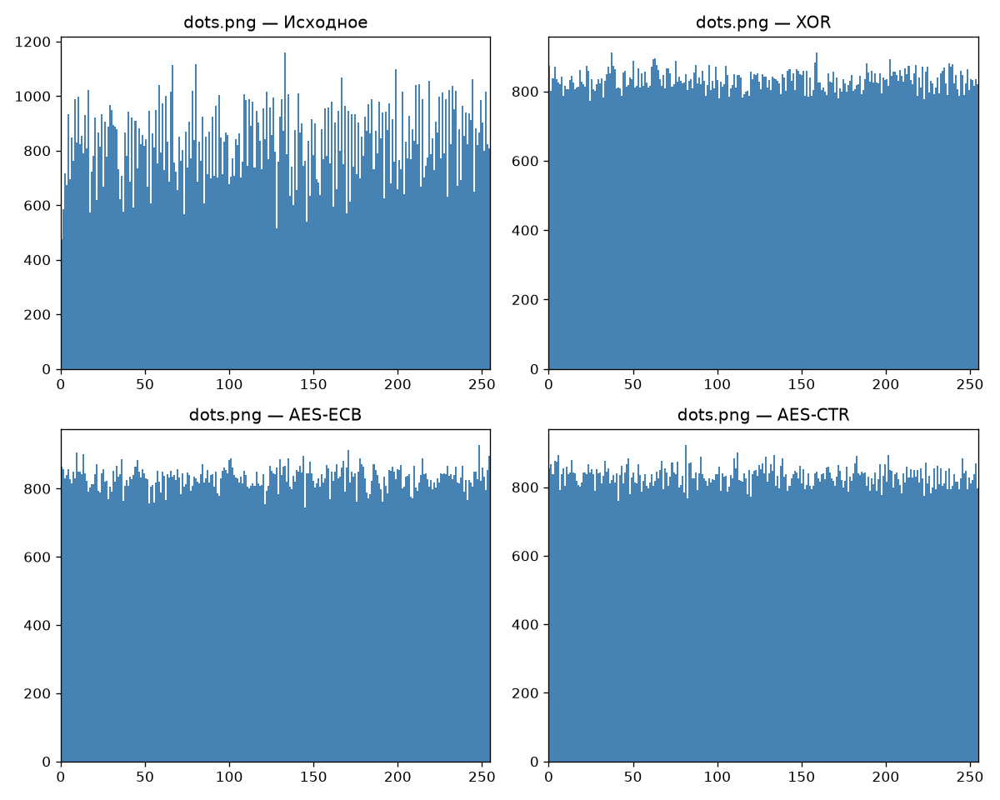

# Шифрование изображений и статистическое сравнение методов

## 1. Описание

В работе используются изображения:
- `checkerboard.png` — шахматная структура;
- `gradient.png` — плавный градиент;
- `dots.png` - точки (собственное изображение).

В папке `results` находятся результаты шифрования по каждой картинке:
- `_sh.png` - зашифрованные картинки;
- `.png` - восстановленные картинки;
- `meta.json` - параметры шифрования;
- `metrics.csv` - таблица с численными результатами;
- `histograms.png` - гистограммы распределения байтов;
- `res.txt` - результаты эксперимента с изменением ключа.

## 2. Реализация методов
### 1. Потоковый вариант: XOR с ключевым потоком

Для потокового шифрования использован генератор `xorshift32`. Строковый ключ шифрования ("secret-key-1") с помощью хеш-функции SHA-256 преобразуется в 32-битное начальное состояние генератора. Генератор в цикле выдаёт 32-битные числа, каждое разбивается на 4 байта — так формируется ключевой поток нужной длины. Шифрование — побайтовый XOR данных с потоком. Расшифрование — та же операция, потому что XOR обратен сам себе.

Зашифрованная картинка:

### 2. AES

Ключ AES-256 получается из строки через SHA-256. В режиме ECB каждый 16-байтный блок шифруется независимо, для некратных длин используется padding. В режиме CTR AES шифрует счётчик (nonce + counter), а результат складывается с данными по XOR, padding не нужен. Nonce (8 байт) генерируется случайно, сохраняется в meta.json и используется при расшифровании.

Зашифрованная картинка:

`ECB`

`CTR`

## 3. Проверка обратимости

На основе описанных выше методов можно увидеть результат проверки обратимости. На картинках мы видим полное побайтовое совпадение исходного и восстановленного файлов.

В консоли выведено кратко:

Тут написано кратко, что все четыре хэша сошлись.

Также в файле `meta.json` можно увидеть подробный вывод:

Все четыре хэша одинаковые. Это доказывает, что исходный файл восстанавливается без ошибок.

## 4. Статистическое сравнение методов

Изображение `dots.png` содержит большое количество повторяющихся областей и плавные переходы, это позволяет оценить как разные методы справляются с данными. (Для всех остальных изображениях проделано то же самое, но в отчете описано только для `dots.png`).

Сводная таблица метрик:

| № | Метод | Энтропия | Corr H | Corr V | Особенности | 
| :-: | :-: | :-: | :-: | :-: | :-: | 
| 1 | Исходное изображение | 7.9822 | 0.7979 | 0.8212 | структура изображения | 
| 2 | XOR | 7.9992 | 0.7021 | 0.6909 | цветной шум | 
| 3 | AES-ECB | 7.9990 | 0.7224 | 0.6963 | цветовой шум с очертаниями исходника | 
| 4 | AES-CTR | 7.9992 | 0.7004 | 0.7097 | цветовой шум | 

Энтропия показывает равномерность распределения байтов, судя по ней, все методы показали отличный результат (около 8 бит). Чтобы увидеть разницу между методами, ы смотрим корреляцию и гистограмму. 

Наиболее низкую корреляцию показывает AES-CTR и XOR, что говорит об их способности разрушать пространственные связи. В то же время у AES-ECB горизонтальная корреляция заметно выше (0.7224), чем у остальных. Это объясняется особенностью ECB: одинаковые блоки исходных данных шифруются одинаково, из-за чего часть исходной структуры сохраняется в шифротексте.

Для оценки корреляции использовался коэффициент Пирсона. Из изображения случайным образом выбирались 5000 пар соседних пикселей для горизонтального направления и 5000 пар — для вертикального. Случайный выбор пар (с фиксированным seed для воспроизводимости) позволяет избежать влияния локальных однородных областей и оценить связь по всему изображению.

Чувствительность к изменению ключа: 

| Метрика | Значение | Пояснение |
| :-: | :-: | :-: |
| NPCR | 99.61% | доля различающихся байтов между двумя шифротекстами |
| UACI | 33.42% | средняя интенсивность различий |

Ход эксперимента:

Исходное изображение было зашифровано ключом K1 = "secret-key-1", получен шифротекст. В ключе был изменён один символ (последняя цифра): K2 = "secret-key-2". То же изображение (с тем же nonce) было зашифровано ключом K2, получен шифротекст. Затем шифротексты были сравнены побайтово.

Значения `NPCR` и `UACI`, приведенные выше, говорят о том, что более 99% байтов шифротекста полностью меняются, а средняя разница между ними составляет около 33%. Алгоритм AES-CTR обладает высокой чувствительностью к ключу, что делает его устойчивым к атакам перебора.

Гистограмма:

Все методы шифрования успешно преобразуют исходное распределение в равномерное (энтропия достигает ~7.999 бит/байт), что подтверждает высокое качество перемешивания. Гистограмма AES-ECB показывает небольшую неравномерность (и это коррелирует с более высокой корреляцией 0.7224), что визуально подтверждает слабость режима ECB: он скрывает частоты отдельных байтов, но не полностью разрушает блочную структуру. В то же время XOR и AES-CTR демонстрируют практически идеальное равномерное распределение.

## 5. Анализ

Сравнение методов по трем ключевым метрикам показало следующее:

- Энтропия: у всех методов она практически одинаковая (~7.999 бит/байт), все алгоритмы успешно скрывают частотные характеристики байтов.

- Корреляция: наименьшая корреляция (около 0.70) у XOR и AES-CTR. У AES-ECB горизонтальная корреляция заметно выше (0.7224). Это доказывает, что ECB хуже разрушает пространственные связи.

- Почему ECB отличается: Режим ECB шифрует 16-байтные блоки независимо, поэтому одинаковые блоки исходника дают одинаковый шифротекст, сохраняя часть структуры. CTR и XOR перемешивают каждый байт независимо, полностью разрушая структуру.

- Согласованность графиков и чисел: визуальный анализ совпадает с цифрами. На гистограммах у XOR и CTR распределение плоское (шум), а у ECB видны наоборот. На картинках шифротекста у ECB заметны очертания исходного изображения, чего нет у CTR/XOR.

## 6. Вывод

В ходе работы были реализованы потоковый XOR (xorshift32), AES-ECB и AES-CTR. Эксперимент показал, что все методы обратимы (хэши SHA-256 совпали) и повышают энтропию до ~8 бит.

Статистический анализ выявил разницу: XOR и AES-CTR лучше разрушают структуру изображения (низкая корреляция, равномерные гистограммы). AES-ECB статистически слабее — он сохраняет часть закономерностей из-за независимого шифрования блоков. Таким образом, для скрытия визуальных паттернов потоковые режимы подходят лучше, чем ECB. Высокие показатели NPCR (99.61%) и UACI (33.42%) подтвердили чувствительность метода к изменению ключа.
